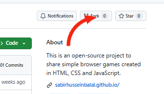
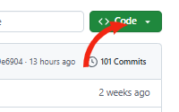
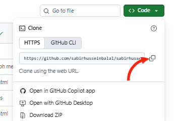

[](https://sabirhusseinbalal.github.io/)
[](LICENSE)


# Small Browser Games

Welcome to Small Browser Games!

This is an open-source project to share simple browser games created in HTML, CSS and JavaScript.

You don't have to be a computer programming expert. This is also for beginners!

## What can you build?

Any simple browser game. For example:

- Tic-Tac-Toe
- Memory Card Game
- Rock Paper Scissors
- Number Guessing
- Word Games
- Puzzle Games

These are only a few examples. Bring your own ideas!

## How to contribute

Read the [rules](CONTRIBUTING.md) first. Then follow these steps.

### 1. Fork this repository

Click the **Fork** button at the top right of this page.



### 2. Clone your fork

On your fork, click the green **Code** button and copy the link.





Then run this in your terminal (use your own username):

```bash
git clone https://github.com/your-username/sabirhusseinbalal.github.io.git
```

```bash
cd sabirhusseinbalal.github.io
```

### 3. Create a branch

```bash
git switch -c add-your-game-name
```

For example: `git switch -c add-memory-game`

<details>
<summary>Got an error with git switch?</summary>

You probably have an older version of Git. Use this instead:

```bash
git checkout -b add-your-game-name
```

</details>

### 4. Add your game

Create this folder, using your GitHub username and your game name:

```
games/your-username/your-game-name/
```

Put exactly three files inside:

```
index.html
style.css
script.js
```

Open `index.html` in your browser and test your game. Try it on a phone-sized screen too.

### 5. Save and upload your work

```bash
git add .
git commit -m "Add memory game"
git push origin add-your-game-name
```

### 6. Open a Pull Request

Go to your fork on GitHub. Click **Compare & pull request**, fill in the form, and send it. I will review it and reply.

## Main rules

- Use only HTML, CSS and JavaScript.
- Exactly three files per game: `index.html`, `style.css`, `script.js`.
- No images, sounds, videos, fonts or other files.
- Your game must work on mobile and desktop.
- Avoid complicated code and make it readable.
- While use of AI tools is allowed, you should know what you are submitting.
- Don't submit code that can't be explained or maintained.

The full list is in [CONTRIBUTING.md](CONTRIBUTING.md).

## Contributors

Many thanks to all who have supported this project!

[](https://github.com/sabirhusseinbalal/sabirhusseinbalal.github.io/graphs/contributors)

## Code of Conduct

We wish to be a friendly and respectful community.

Please read our [Code of Conduct](CODE_OF_CONDUCT.md).

## License

MIT. See [LICENSE](LICENSE).

## Play and explore

Visit the website:

[Small Browser Games](https://sabirhusseinbalal.github.io/)

## Project Repository

[View on GitHub](https://github.com/sabirhusseinbalal/sabirhusseinbalal.github.io)

---

Made with ❤️ by people who enjoy building games.
